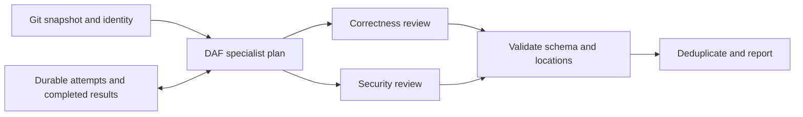

# Resumable changed-file review

`daf review` applies correctness and security specialists to a bounded snapshot of tracked changes. It runs real registered DAF workers through `SpecialistPlan`, validates their structured findings, and combines exact duplicates. The current specialist executor is sequential; the reviewers receive independent prompts.

```sh
cargo build --locked -p daf
./target/debug/daf review --repo /path/to/repo --base HEAD \
  --state-dir /path/to/review-runs/change-001 --model YOUR_MODEL
```

The provider is the installed, authenticated Codex CLI. `--provider-executable` selects its executable. No shell command string is evaluated. JSON on stdout is the report; the run directory retains the durable journal. Use a state directory outside the reviewed repository. Run the same command with the same inputs to resume. Choose a new run directory after changing the reviewed content or provider configuration; a fingerprint mismatch rejects stale reuse.

## Execution and recovery



The journal records an attempt before invoking the provider. A successful validated result becomes reusable only after persistence. Resuming skips completed specialists. Retries remain bounded across restarts. An unfinished attempt is marked interrupted, with unknown usage; `--allow-unknown-retry` explicitly permits another potentially billed attempt. This workflow does not guarantee exactly-once model inference. A provider can finish or bill a request before the local receipt is durable.

A run directory is locked against simultaneous writers. Checkpoints use atomic replacement and synchronization. Model output must match the strict finding schema, identify a changed reviewable file and use an in-bounds line. Validation establishes structure and location, not that a reported defect is correct. Repository tests and human assessment remain separate evidence.

## Usage evidence

Each attempt retains provider-reported input, cached-input and output tokens when available. CLI JSON includes `usage_summary` with known subtotals and a count of attempts with incomplete usage; the Rust API exposes `ReviewReport::usage_summary()`. Missing fields remain null. Unsupported multiple-completion streams fail the attempt and mark all counters unknown rather than undercounting earlier receipts. Invalid findings and failed attempts retain observed usage; cached completed reviews do not create new provider calls. Cached-input tokens are reported separately and must not be added to input tokens as if they were new input. Token counts are not a price estimate. Select an explicit `--model` for repeatable configuration. Provider-side model aliases and default-model changes cannot be detected from local configuration alone. Interrupted calls can leave billing unknown.

## Scope and design knowledge

This workflow adds an application contract above existing DAF plans, workers and retry semantics. It does not replace DDAL, create a new scheduler or assert feature parity with another agent product. The remote durable ledger guarantees replay of committed receipts and declared storage effects; that guarantee cannot be extended to external model billing. Consequently review attempts have their own explicit durable lifecycle.

The design follows the reusable-workflow lesson from [Claude Code workflows](https://code.claude.com/docs/en/workflows): named contracts, validated results and explicit recovery matter more than adding another set of agent-spawn commands. Existing DAF plans already provide dependencies, capability admission and retries. This implementation supplies the application lifecycle and provider evidence that were missing.

The first version targets tracked textual changes against a commit. Untracked files must be added to Git before review. Check the run report and errors for unsupported inputs; do not interpret an omitted file as reviewed. The provider runs with a read-only sandbox, but repository contents are still untrusted model input. Findings are advisory output and never execute commands.

## Verification

Run `cargo test --locked -p daf-review` for provider parsing, local validation and subprocess recovery fixtures. Run `cargo test --locked -p daf` for CLI checks. Deterministic fixture tests verify orchestration and persistence; a separately recorded live-provider smoke establishes actual inference and usage reporting. See [the dated verification report](REVIEW-VALIDATION-2026-10-15.md) for commands actually run and their results.
