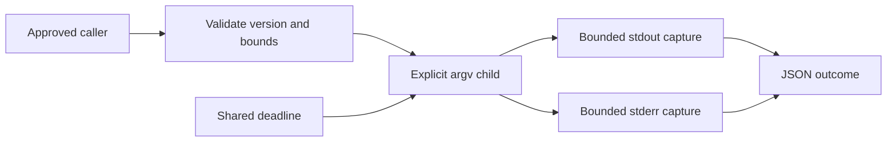

# Portable coding-agent process adapter

`daf-adapter` is a small standalone Rust binary. `daf adapter` exposes the same implementation in the full DAF CLI. The adapter runs a user-approved executable once, without inserting a shell or automatically retrying side effects. It interoperates with any coding CLI that accepts explicit arguments and optional standard input. Interactive terminal protocols, provider authentication and model semantics remain the caller's responsibility.

```sh
cargo build --locked -p daf-adapter
./target/debug/daf-adapter capabilities
./target/debug/daf-adapter run request.json
# Equivalent in the full CLI:
daf adapter run request.json
```

A request is one UTF-8 JSON object (at most 1 MiB). Pass `-` instead of the filename to read it from stdin. Unknown and duplicate fields are errors. Both raw input and normalized compact UTF-8 JSON (including defaults and null optional fields) must fit the request limit.

```json
{"schema_version":1,"id":"inspect","argv":["git","status","--short"],"cwd":".","stdin":null,"timeout_ms":300000,"max_output_bytes":65536}
```

| Field | Contract and reason |
| --- | --- |
| `schema_version` | Integer 1; incompatible versions fail before execution. |
| `id` | Nonblank, at most 128 UTF-8 bytes; correlation only, not durable deduplication. |
| `argv` | 1–4096 NUL-free strings with a nonempty executable; preserves argument boundaries. |
| `cwd` | Optional existing directory, resolved from the caller's directory; empty paths fail. |
| `stdin` | Optional string sent as UTF-8; EOF is always delivered. |
| `timeout_ms` | Integer 1–3,600,000, default 300,000; bounds child execution, input writing and output draining. |
| `max_output_bytes` | Integer 1–1,048,576, default 65,536; retained raw bytes per output stream. |

Both pipes are drained concurrently even after reaching their retention cap. This avoids pipe-buffer deadlock without retaining unlimited output. Raw bytes are truncated before lossy UTF-8 decoding, so a replacement character can make the encoded result string slightly larger than the raw cap. Input, output and the deadline are operational bounds, not resource isolation: CPU, filesystem, network and inherited environment permissions remain those of the caller.

Valid requests return exactly one JSON outcome on stdout with `schema_version`, `id`, `status`, nullable `exit_code`, `stdout`, `stderr`, `stdout_truncated` and `stderr_truncated`. Status is `succeeded`, `failed` or `timed_out`. Successful process exit produces adapter exit 0; valid failed/timed-out execution produces exit 1. Invalid input or adapter infrastructure errors produce exit 2 and diagnostics on stderr. Spawn failures are valid `failed` outcomes. IDs are echoed; requests are not persisted or retried.

At timeout, the direct child is terminated and reaped. Library-future cancellation uses Tokio kill-on-drop as a fallback; explicit awaited reaping is guaranteed by the ordinary timeout path, not by an externally dropped future. Capture futures close their pipes. Descendants are not recursively killed; callers requiring containment must supply a process supervisor or sandbox. When a child exits but its descendant keeps a pipe open, the complete operation still reaches its deadline.

## DJCODE integration boundary

DJCODE can invoke this binary from its approved tool-dispatch boundary or wrap it with the companion Python package. Keep tool approval, exact argument matching, dependency validation and cancellation owned by DJCODE. This binary is **not** a replacement for `DJCODE_DAF_ENGINE`: that scheduler host has a separate protocol requiring authentic DDAL event evidence. Reusing that variable for a process adapter would weaken its validation.

The process protocol offers extensibility through configured argv rather than claiming that every vendor CLI, interactive mode or model has been tested. No credentials are embedded, no global CLI settings are changed and no paid provider request is required for the local conformance tests.

## Mathematical bounds

For input size `I`, per-stream retention cap `B`, and fixed read buffer `K = 8192`, capture storage is `O(I + 2B + 2K)`, excluding runtime and child-process memory. Execution's deadline is `T`; termination/reaping and scheduler overhead can extend observed wall time beyond `T`. Draining excess bytes uses CPU proportional to emitted bytes until completion or timeout; retained memory does not grow with that excess.



Verify with `cargo test --locked -p daf-adapter` and `cargo clippy --locked -p daf-adapter --all-targets -- -D warnings`. Tests use local Python processes to exercise nonzero exits, literal stdin, concurrent pipe draining, truncation, invalid contracts, working directories, spawn errors, blocked stdin and inherited pipes.
